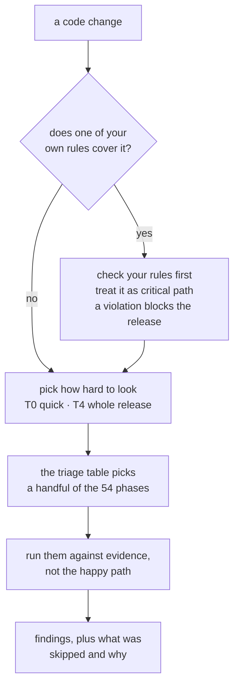

# The Audit Protocol

A checklist your coding agent runs before you ship — plus a way to write down
the two or three things that would be a genuine disaster **in your project
specifically**.


> ### This is not a Claude Code tool
>
> It is **one markdown file**. Any coding agent that can read a file in your
> repository can run it — Claude Code, Cursor, Codex, Windsurf, Copilot, Aider,
> Zed, or whatever you use next year. There is nothing to install, no runtime,
> no dependency, and no API to call.
>
> A Claude Code plugin ships here as a convenience for people who want it in
> every project without copying a file. It is optional, and skipping it costs
> you nothing.

> Community project. Not affiliated with or endorsed by Anthropic.

## Thirty seconds

```bash
curl -O https://raw.githubusercontent.com/sturec5/code-audit-protocol/main/AUDIT_PROTOCOL.md
```

Then, to your agent:

```
Audit the current change against AUDIT_PROTOCOL.md. Tell me the tier, which
phases you ran, and which you skipped and why.
```

That is the whole integration. There is nothing else to install. What comes back
ends like this:

```
Phases run:     24, 1-4, 7, 16, 17, 19, 20, 28, 42
Phases PARTIAL: 53-54 — both want the running system; only the declarations
                in the repository were read
Phases skipped: 47-49, 51-52 (no auth, migration or UI change), and 5-6, 8-15,
                18, 21-23, 25-27, 29-41, 43-46, 50 — nothing here reaches them
Could not establish: whether the counter holds under real concurrent load
```

**Those last three lines are the product.** Findings are what any review gives
you. An account of what went unexamined, and why, is what makes the answer worth
anything — and it is the part you will not get by asking an agent to "review
this".

## The 60-second version

You changed some code. Before it ships, something should ask *what did I miss?*

This repo gives your agent two things.

**1. A list of 54 ways software breaks.** A number that rounds the wrong way.
One user reading another user's data. A test that would pass even against
broken code. A migration that works on an empty database and locks up on a real
one. These are the same in every codebase, which is why the list is worth
keeping.

**2. A short file where you write down your own disasters.** The generic list
cannot know that in *your* app the thing that ends you is a payment charged
twice. So you write that down yourself — a handful of rules, six to eight once
it has matured. That file is called an **overlay**.

Then one rule connects them: **the overlay wins.** Any change that touches it
gets the full treatment, however small the change looks.



The left branch is the part no generic checklist has. Everything below the
fork is the ordinary machinery.

## Why `AUDIT_PROTOCOL.md` is over 1,500 lines — and why you should not read it

**You are not the reader. Your agent is.**

It is long the way a dictionary is long: exhaustive on purpose, opened a few
entries at a time, never read front to back. Each of the 54 phases is a way
something actually broke for somebody. Writing them all down is the point.
Reading them all is not.

What you read is this page. Then you hand the file to your agent, and it uses
the triage table inside to pick the phases your change actually needs — an
accessibility fix does not get the database phases.

**If you never open `AUDIT_PROTOCOL.md`, this still works.**

## Try it in one minute

Two ways in, and you need only one: put the file in your repository, or — in
Claude Code — install the plugin. Doing both leaves two copies that can drift;
if you have both, the one in your repository wins. It is pinned to your project
and you can edit it.

### Any agent — Cursor, Codex, Windsurf, Copilot, Claude Code, anything

The `curl` and the prompt at the top of this page, and nothing else. The agent
reads a file and follows it. Commit `AUDIT_PROTOCOL.md` and everyone on the
project has it.

### Claude Code — optional convenience

Installs it once and makes it available in every project, so you never copy the
file again:

```
/plugin marketplace add sturec5/code-audit-protocol
/plugin install audit-protocol@code-audit-protocol
```

**Restart Claude Code before you use it.** The skill is not registered in the
session that installed it, and the install says nothing about that — ask for an
audit there and you get an ordinary review with no protocol behind it.

The same applies to updates, which do say so. A session reads the skill once, at
startup, and keeps serving that copy: a plugin updated mid-session goes on
behaving like the version it began with until you restart.

It holds in reverse too, and this one has no warning at all: a session goes on
offering the skill after the plugin's directory has been moved or deleted, and
only finds out when it tries to read the taxonomy. If an audit tells you it
cannot reach the protocol, restart before concluding the install is broken.

After the restart there is nothing to copy. Ask in your own words:

```
Audit the current change.
```

Whether a skill loads on its own is the agent's judgement, not something this
repository controls — and an agent confident it can review code will sometimes
improvise one instead. The tell is in the output: a real run states a tier, the
phases it ran, and the phases it skipped with reasons. If you get a review with
none of that, name it and ask again:

```
Use the audit-protocol skill to audit the current change.
```

An audit that cannot tell you what it did not check is not this protocol,
whatever else it got right.

The plugin ships one skill and nothing else — no hooks, no commands, no agents,
no MCP servers. It grants no permissions and changes no behaviour until you ask
for an audit.

### What to type, and what it runs

Two dials, both optional. **Scope** is what gets looked at; **tier** is how hard.
Say either, both, or neither — say neither and the agent picks and tells you.

| Type this | And it runs |
| --- | --- |
| `Audit the current change.` | agent picks scope and tier from the diff, and names both |
| `Audit the checkout module.` | one module, however old the code in it is |
| `Audit the signup journey end to end.` | one path through the system, across files |
| `Audit this change, T1.` | your scope, kept shallow — core phases only |
| `Audit the auth module, T3.` | both dials set: critical-path depth on one module |
| `Audit this release, T4.` | the release battery, phases 47-54 included |
| `Audit this fix, and check for the same pattern elsewhere.` | names the sibling sweep, which is already core for bug fixes — insurance, not an upgrade |

There is no "audit the whole project", on purpose. A codebase declared reviewed
after one sweep is the failure this exists to prevent — name a part, then come
back for the next part. [`HOWTO.md`](HOWTO.md) works one of these end to end.

**New here?** [`HOWTO.md`](HOWTO.md) walks through one real example end to end —
run an audit, read the output, write your first overlay, see what changes.
Fifteen minutes.

## The one idea worth understanding: overlays

Think of a medical checkup.

The 54 phases are the **standard checkup**. Blood pressure, heart, lungs. The
same for every patient, which is why it is worth having a fixed list.

An overlay is the line on your chart that says **allergic to penicillin**. It
is true for you and almost nobody else, no general checkup would ever discover
it, and it **overrides everything** — whatever else is going on, that drug
does not get administered.

Your project has allergies. The generic list cannot know them. You write them
down once.

Here is what that buys you. Say you run a store. You change one line in the
shipping-address form — a label, basically. Trivial.

Except that form writes to the order record, and the order record is what the
payment retry reads. Your overlay says: *money must never move twice.* So this
one-line change is now a critical-path review — not because the diff is big,
but because of **what it touches**.

That inversion is the whole idea:

> Risk comes from what a change touches, not from how many lines it has.

A generic checklist cannot do this. It does not know what your disaster is.
You do — so you write it down once, and every future change gets measured
against it.

This is also why the two files are separate. The 54 phases transfer to any
project unchanged. Your overlay transfers to nobody, and that is exactly the
point: it is the part that knows something the generic list never can.

## What an overlay actually looks like

An overlay is a list of **invariants**. An invariant is just a thing that must
never stop being true — written so that someone can go and prove it, yes or
no. "Review the payment code" is not one; there is no answer to it. This is:

> **A retried request must not create a second charge.**
>
> **Prove it:** send the same request twice with the same idempotency key and
> show one charge in the ledger.
>
> **Violation looks like:** the key is generated inside the retry loop; the
> ledger has no uniqueness constraint; a webhook handler that trusts delivery
> order.

Start from the failure, not the feature. "Checkout flow" is a feature. "Money
moved twice" is a failure class, and it survives the refactor that renames
checkout.

If the only proof you can offer is "I read it and it looked right", it is not
an invariant yet.

### The `overlays/` folder is examples, not a library

Nothing in it is meant to be installed, imported, or copied as-is. They are
four allergy charts written for four imaginary patients:

- [payments](overlays/payments.md) — a system that moves money
- [access-control](overlays/access-control.md) — a system with user accounts
- [data-pipeline](overlays/data-pipeline.md) — a system that learns from data
- [evidence-chain](overlays/evidence-chain.md) — a system whose product is the record

If you do not handle money, `payments.md` means nothing to you. That is fine —
delete the folder and the repo still works.

They ship because "write down the invariants specific to your system" is
useless advice until you have seen one. Open whichever is closest to your
project, take the shape, then write your own from
[`OVERLAY_TEMPLATE.md`](OVERLAY_TEMPLATE.md).

## Why not just ask your agent to review the code?

You can, and you should — that catches a lot. Three things it does not give
you.

**It cannot know your allergies.** A review that does not know a double
redemption costs you money treats it as an ordinary race condition, or misses
it entirely. Nothing but you can supply that.

**It is different every time.** Ask twice, get two different reviews, neither
of which tells you what it did not look at. A fixed list makes the second
audit comparable to the first.

**"Looks fine" is not the same as "I checked twelve things and skipped eight,
here is which and why."** The second one is auditable. The first is a mood.

This is not a replacement for the review tools built into your agent. It is
the checklist they run against, and the place your own invariants live.

## What is in here

| File | Who reads it |
| --- | --- |
| `README.md` | You. What this is and why. |
| [`HOWTO.md`](HOWTO.md) | You. One worked example, start to finish. Read this second. |
| [`AUDIT_PROTOCOL.md`](AUDIT_PROTOCOL.md) | Your agent. 54 phases, tiers, finding standard, triage table. |
| [`OVERLAY_TEMPLATE.md`](OVERLAY_TEMPLATE.md) | You, once — when you write your first overlay. |
| [`overlays/`](overlays/) | Four worked examples, for reference. |
| [`templates/`](templates/) | Report formats to copy into your repo: one finding, and the standing "can this ship?" record. |
| [`CONTRIBUTING.md`](CONTRIBUTING.md) | You, if you want to add an overlay — start here, not with a pull request. |
| [`SECURITY.md`](SECURITY.md) | You, if you want to know what executes here, or need to report something. |
| `check.sh`, `check_test.sh`, `denylist.example` | Only if you fork this and publish your own version. |
| `.claude-plugin/`, `skills/` | The Claude Code plugin wrapper. |

## Three things that make it worth using

**An unrun checklist is not evidence that anything is safe.** This is a list of
questions, not a certificate. Phases you skip get recorded as skipped, with the
reason — so "we did not check that" never quietly becomes "that is fine".

**A green test suite does not prove the tests mean anything.** Separate phases
exist to audit the tests themselves, because an assertion that would also pass
against broken code is worse than no assertion.

**A hunch is not a defect.** Every finding carries evidence, a reproduction,
and a status: CONFIRMED if it was reproduced, PLAUSIBLE if it was only reasoned
about. A finding with neither is a rumor with an ID number.

## Where this came from

Distilled from audit protocols used across several production codebases — a
user-facing web application, a real-time service, and a data-processing system.
The phase list grew one entry at a time, each added after something got through
that nothing on the list would have caught.

The last eight phases — security, authorization, storage and recovery, privacy,
accessibility, UX, observability, delivery — are grounded in public standards
rather than one team's habits: OWASP ASVS and API Top 10, the NIST Privacy
Framework and SSDF, WCAG 2.2, and the Google SRE material on service level
objectives. Every source is cited at the end of the protocol.

Nothing project-specific ships here. [`check.sh`](check.sh) is the gate that
keeps it that way; run it before every push. Its term list lives in an
untracked `denylist.local` rather than in the script — the names you are
keeping out of a public repository should not be published by the tool that
keeps them out. [`denylist.example`](denylist.example) shows the format.

## Contributing

An overlay for a failure class nobody has covered yet is the most useful
contribution — see [CONTRIBUTING.md](CONTRIBUTING.md). A new phase is a higher
bar: it earns its place only when a real failure class has no existing home.

MIT licensed. Use it, fork it, delete the parts you do not need.
